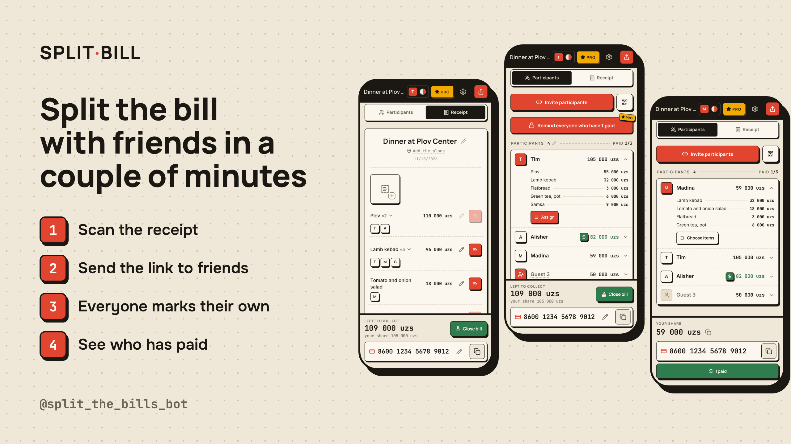
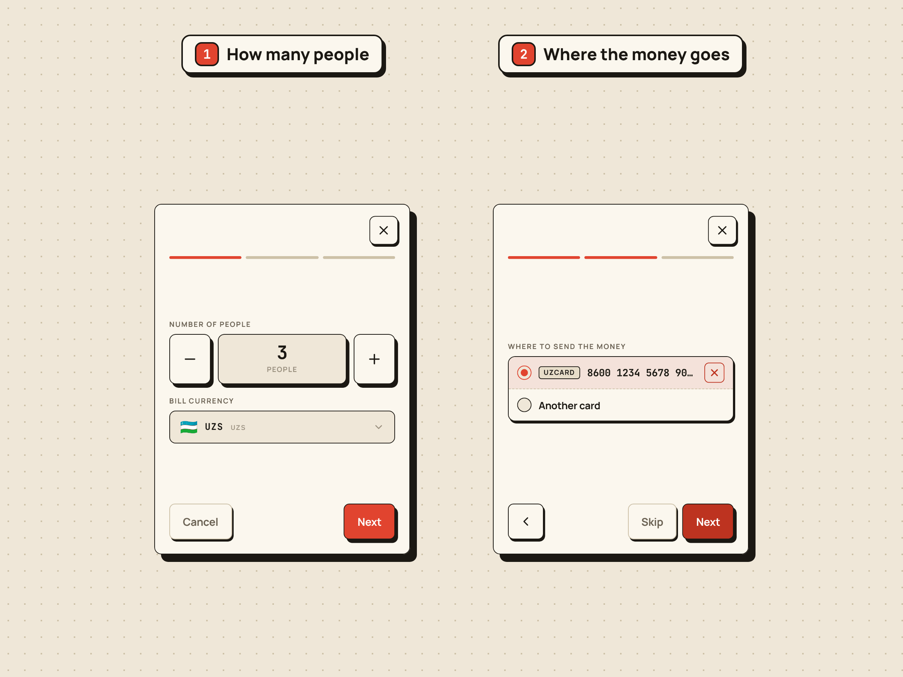
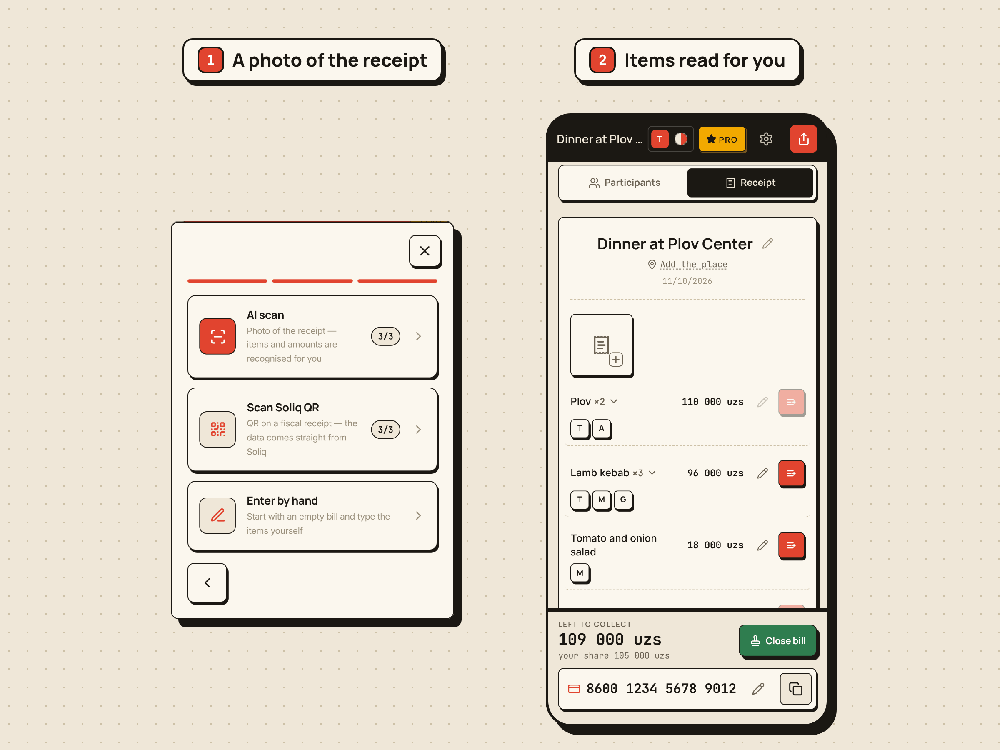
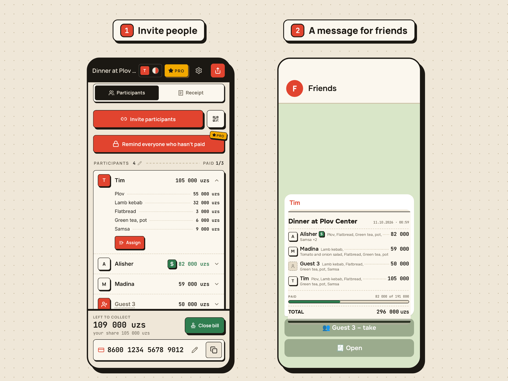
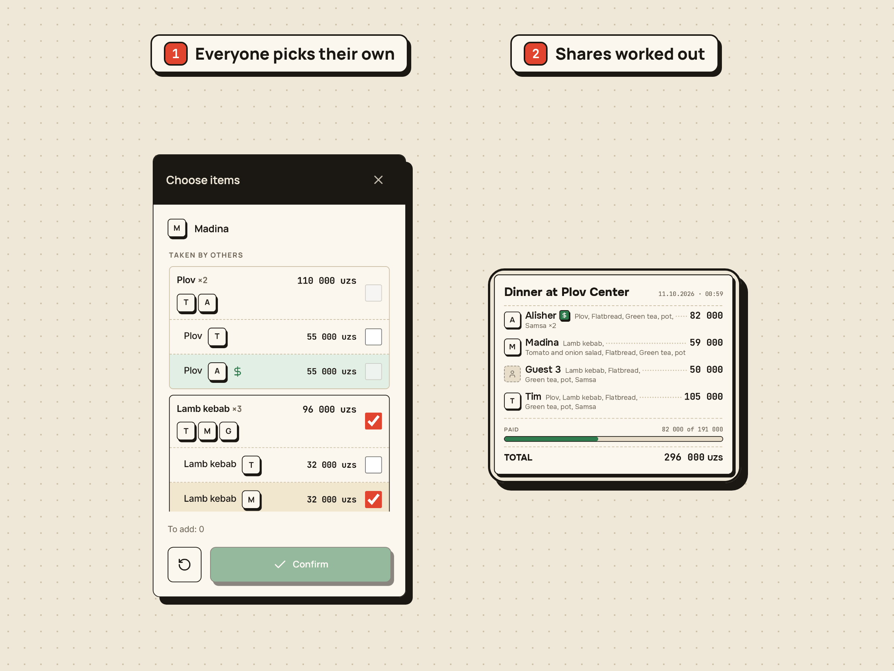
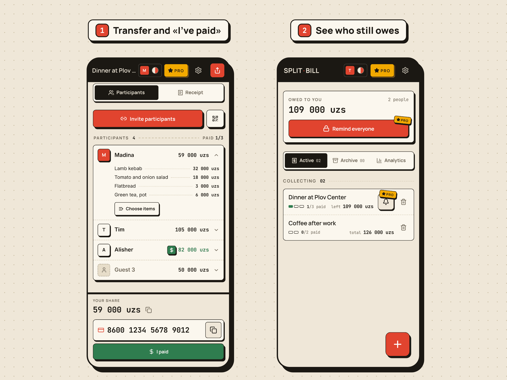
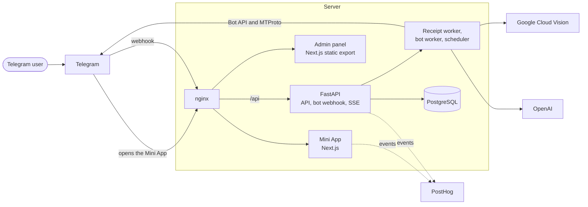

<div align="center">

# Split·Bill

**Split a restaurant bill with friends in a couple of minutes — right inside Telegram.**

A Telegram Mini App and bot: scan the receipt, send one link, everyone taps what they had,
and the app shows who still owes and where to transfer.

[](LICENSE)




</div>

> [!NOTE]
> **This project is archived.** It ran in production as a Telegram bot and is now closed.
> The full source is published as is under the [MIT License](LICENSE): fork it, learn from it, build on it.
> Issues and pull requests are not monitored.

## Contents

- [How it works](#how-it-works)
- [Features](#features)
- [What you can build with this code](#what-you-can-build-with-this-code)
- [Architecture](#architecture)
- [Tech stack](#tech-stack)
- [Getting started](#getting-started)
- [Configuration](#configuration)
- [Running tests](#running-tests)
- [Adapting it to your market](#adapting-it-to-your-market)
- [Project structure](#project-structure)
- [License](#license)

## How it works

<table>
  <tr>
    <td width="50%"></td>
    <td width="50%"></td>
  </tr>
  <tr>
    <td align="center"><b>1. Start a bill</b><br>How many people, and the card the money goes to.</td>
    <td align="center"><b>2. Scan the receipt</b><br>A photo becomes a list of items, prices and quantities.</td>
  </tr>
  <tr>
    <td></td>
    <td></td>
  </tr>
  <tr>
    <td align="center"><b>3. Invite friends</b><br>One link or QR code; the post in the chat updates itself live.</td>
    <td align="center"><b>4. Everyone picks their own</b><br>Shares are worked out, shared dishes split evenly.</td>
  </tr>
  <tr>
    <td></td>
    <td></td>
  </tr>
  <tr>
    <td align="center"><b>5. Pay and settle</b><br>«I've paid», reminders, and the bill closes itself once settled.</td>
    <td></td>
  </tr>
</table>

<sub>Screenshots of the running app with made-up data, drawn by <a href="tools/bot-media">tools/bot-media</a>.</sub>

## Features

**Splitting the bill**
- Items with quantities and portions; a dish can be shared by several people or by the whole table.
- Seats for guests without an account: a friend joins later and takes a free seat.
- Hand out dishes by tapping or by dragging them onto people; everyone sees exactly what they owe.
- Live updates over Server-Sent Events: the whole table sees the same bill at the same moment.
- Card numbers stored encrypted with AES-GCM, «I've paid» confirmations, auto-close once everyone has paid.

**Getting the receipt in**
- Photo scan: Google Cloud Vision reads the text, an OpenAI model turns it into structured items.
- Uzbekistan fiscal receipts: import straight from the QR code on the check (`ofd.soliq.uz`).
- Voice: describe the bill out loud and the model applies it as an edit.
- Manual entry and editing of every line.

**Telegram integration**
- Mini App signed in with Telegram `initData`, verified by HMAC on the server.
- A bot that runs the whole flow in chat: create a bill, take the receipt, invite people.
- Bills shared into group chats through inline mode: the post edits itself as the bill changes, and its buttons let people take a seat or mark themselves paid.
- Pro plan paid with Telegram Stars, plus promo codes and granted Pro.
- Year-in-review cards shared to Telegram Stories.

**Getting people to pay**
- Automatic payment reminders with a growing cadence and quiet hours in the local time zone.
- «Remind everyone who hasn't paid» in one tap.
- Sender accounts (MTProto via Telethon) to reach people who blocked the bot.

**Analytics for users**
- Spending by month, year or all time: places, dishes and the people you eat with.
- Receipt lines and places labeled by an LLM in batches, so different spellings of one dish count as one.
- Badges such as «Coffee lover» or «Night owl» next to a name.

**Admin panel**
- Dashboard, users, bills, receipt scans, dish and place catalogues, labeling queue.
- Broadcasts with media and a test send, reminders, sender accounts, bot update queue, user feedback.
- Pro pricing, grants and promo codes; runtime settings such as the receipt model.

**Product quality**
- Three languages in the app and the bot: English, Russian, Uzbek.
- Light, dark and Pro themes; a guided onboarding tour with a demo bill.
- Product analytics in PostHog, one event name per action across the app, the bot and the server.
- Over 220 test files across the backend (pytest), the Mini App and the admin panel (Vitest), run in CI on every pull request.

## What you can build with this code

It is a complete product that ran in production, so you can take all of it or just the parts you need.

| Idea | What to reuse |
| --- | --- |
| **Your own bill-splitting bot** for another country or city | Everything. Rebrand, set the currency and languages, plug in your bot token. |
| **Shared expenses app** for trips, flatmates or office lunches | The split engine: items, portions, shared items, guests, balances and «I've paid». |
| **«Split at the table» for a café or restaurant** | Invite links and QR codes that open a bill; the venue prints the QR on the check. |
| **Receipt scanning** for expense tracking, cashback or bookkeeping | The OCR + LLM pipeline in [`backend/app/worker.py`](backend/app/worker.py) and the labeling in [`services/labeling.py`](backend/app/services/labeling.py). |
| **A starter kit for Telegram Mini Apps** | `initData` validation, a browser mock of `Telegram.WebApp` for local work, themes, SSE, i18n, an onboarding tour. |
| **A Telegram bot with live posts** | Inline messages that keep editing themselves, a webhook queue that keeps each chat in order, Stars subscriptions, broadcasts. |
| **Personal finance insights** | Period analytics, badges and story cards drawn with Pillow ([`services/analytics.py`](backend/app/services/analytics.py), [`services/story_cards.py`](backend/app/services/story_cards.py)). |

> [!IMPORTANT]
> Sending messages from user accounts (sender accounts) is subject to Telegram's terms of service. Use it with care, or leave it off.

## Architecture



- **Backend**: one FastAPI process serves the Mini App API, the admin API and the Telegram webhook. Receipt scans, bot updates and scheduled jobs run as background workers inside it; each job holds a Postgres advisory lock, so several replicas never send the same reminder twice.
- **Mini App**: Next.js App Router with Zustand and Framer Motion, talking to `/api` through nginx.
- **Admin panel**: a separate Next.js app exported as static files and served by the same nginx.
- **Deployment**: Docker Compose. [`docker-compose.yml`](docker-compose.yml) has a `local` profile (hot reload, a browser mock of Telegram, local Postgres) and a `dev` profile (built images behind a Cloudflare Tunnel); [`docker-compose.prod.yml`](docker-compose.prod.yml) runs prebuilt images behind nginx with TLS.

## Tech stack

| Layer | Technologies |
| --- | --- |
| Backend | Python 3.11, FastAPI, SQLModel, Alembic, PostgreSQL 17, Pillow, Telethon |
| AI | Google Cloud Vision (OCR), OpenAI (receipt structuring, voice, labeling) |
| Mini App | Next.js 16, React 19, TypeScript, Tailwind CSS 4, Zustand, Framer Motion, lucide-react |
| Admin panel | Next.js 16 (static export), React 19, Tailwind CSS 4 |
| Infrastructure | Docker Compose, nginx, Cloudflare Tunnel, GitHub Actions |
| Analytics | PostHog |
| Tests | pytest, Vitest, Testing Library |

## Getting started

### Prerequisites

- Docker with Docker Compose
- `make` (optional)
- For a real bot: a bot from [@BotFather](https://t.me/BotFather) and a public HTTPS address (a Cloudflare Tunnel works)
- For receipt scanning: an OpenAI API key and a Google Cloud service account with the Vision API enabled

### Run it locally in the browser

No Telegram account or tokens needed: in development the Mini App installs a mock of `Telegram.WebApp`.

```bash
git clone https://github.com/BopoHL/split-the-bill.git
cd split-the-bill
cp .env.example .env
```

In `.env`, let the backend accept the mock's unsigned sign-in and point it at the Postgres container:

```dotenv
ALLOW_UNSIGNED_INIT_DATA=true
DB_USER=postgres
DB_PASSWORD=secret
DB_NAME=split_the_bill_db
```

Start the stack and create the tables:

```bash
make docker-up
make db-upgrade
```

Open <http://localhost>. Add `?mockUser=alice` or `?mockUser=bob` to the address to see the same bill as someone else.

> [!WARNING]
> `ALLOW_UNSIGNED_INIT_DATA=true` lets anyone claim to be any user. Use it only on your own machine.

### Connect a real Telegram bot

1. Create a bot with [@BotFather](https://t.me/BotFather) and set `TG_TOKEN`, `TG_BOT_USERNAME` and `NEXT_PUBLIC_TELEGRAM_BOT_USERNAME`.
2. Expose the app over HTTPS and set `PUBLIC_BASE_URL` to that address. The `dev` profile includes a Cloudflare Tunnel: set `CLOUDFLARE_TUNNEL_TOKEN` and `COMPOSE_PROFILES=dev`.
3. In BotFather, set the Mini App URL to `PUBLIC_BASE_URL` and turn on inline mode with inline feedback, so shared posts can update themselves.
4. Point the webhook at the backend, with a secret of your choice in `TG_WEBHOOK_SECRET`:

   ```bash
   curl "https://api.telegram.org/bot$TG_TOKEN/setWebhook" \
     --data-urlencode "url=$PUBLIC_BASE_URL/api/telegram/webhook" \
     --data-urlencode "secret_token=$TG_WEBHOOK_SECRET"
   ```

5. Set `ALLOW_UNSIGNED_INIT_DATA=false` and a real `PAYMENT_ENC_KEY` (see [Configuration](#configuration)).

### Admin panel

Set `ADMIN_EMAIL`, `ADMIN_PASSWORD` and `ADMIN_JWT_SECRET` in `.env`, then run the panel from `admin/` with `npm ci && npm run dev` (port 3100). It calls the API at `/api/admin`; set `NEXT_PUBLIC_ADMIN_API_URL` when the API lives elsewhere. For production, `npm run build` exports static files for nginx.

## Configuration

Everything is set with environment variables; [`.env.example`](.env.example) lists each one with a comment. The ones that matter most:

| Variable | Needed for | Notes |
| --- | --- | --- |
| `TG_TOKEN`, `TG_BOT_USERNAME` | the bot, signed sign-ins | From BotFather |
| `PUBLIC_BASE_URL` | bot buttons, shared pictures | Public HTTPS origin, no trailing slash |
| `TG_WEBHOOK_SECRET` | trusting webhook calls | The same value as `secret_token` in `setWebhook` |
| `DB_HOST`, `DB_USER`, `DB_PASSWORD`, `DB_NAME` | PostgreSQL | Without them the backend falls back to SQLite |
| `PAYMENT_ENC_KEY` | encrypting card numbers | Base64 of 32 random bytes: `openssl rand -base64 32` |
| `OPENAI_API_KEY` | receipt scans, voice, labeling | Models: `OPENAI_RECEIPT_MODEL`, `OPENAI_LABEL_MODEL`, or pick them in the admin panel |
| `GOOGLE_APPLICATION_CREDENTIALS` | receipt OCR | Path to a service-account JSON inside the container, e.g. `/app/google-credentials.json` |
| `SOLIQ_API_SECRET` | Uzbek QR receipts | Only for the `ofd.soliq.uz` import |
| `TG_API_ID`, `TG_API_HASH` | sender accounts | An app from [my.telegram.org](https://my.telegram.org) |
| `REMINDER_*`, `AUTO_CLOSE_*` | reminders, auto-close | Cadence, quiet hours and time zone |
| `ADMIN_EMAIL`, `ADMIN_PASSWORD`, `ADMIN_JWT_SECRET` | admin panel | A single operator account |
| `NEXT_PUBLIC_POSTHOG_KEY`, `POSTHOG_KEY` | product analytics | Leave empty to send nothing |

## Running tests

```bash
# Backend, inside the running container
make test-backend

# Mini App and admin panel
cd frontend && npm ci && npm test
cd admin && npm ci && npm test
```

CI ([`.github/workflows/checks.yml`](.github/workflows/checks.yml)) runs the backend tests, checks that the Alembic migrations apply and have a single head, and tests and builds both frontends on every pull request.

## Adapting it to your market

The app was built for Uzbekistan, so a few defaults are local:

- **Currency**: every bill carries its own currency, and amounts are stored in minor units. UZS by default.
- **Languages**: Mini App strings are in [`frontend/src/lib/i18n/translations.ts`](frontend/src/lib/i18n/translations.ts), the bot's in [`backend/app/utils/bot_copy.py`](backend/app/utils/bot_copy.py).
- **Time zone**: `REMINDER_TZ` and `AUTO_CLOSE_TZ`, `Asia/Tashkent` by default.
- **Fiscal receipts**: the QR import in [`backend/app/services/soliq.py`](backend/app/services/soliq.py) is specific to Uzbekistan; photo scanning works anywhere.
- **Bot pictures**: redraw them in your languages and brand with [`tools/bot-media`](tools/bot-media).

## Project structure

```text
.
├── backend/                 FastAPI app, Telegram bot, workers and scheduler
│   ├── app/routers/         HTTP API: Mini App, bot webhook, admin
│   ├── app/services/        business logic: bills, splitting, receipts, bot, Pro, analytics
│   ├── app/jobs/            scheduled jobs: reminders, auto-close, broadcasts, cleanup
│   ├── migrations/          Alembic migrations
│   └── tests/               pytest suite
├── frontend/                Telegram Mini App (Next.js App Router)
├── admin/                   admin panel (Next.js, static export)
├── nginx/                   reverse-proxy configs for local, dev and prod
├── tools/bot-media/         Playwright scripts that draw the bot's pictures from the running app
├── docker-compose.yml       local and dev stacks
└── docker-compose.prod.yml  production stack
```

`docker-compose.prod.yml` pulls images from the original author's private registry: build your own from the `backend`, `frontend` and `admin` Dockerfiles and change its `image:` lines.

## License

Released under the [MIT License](LICENSE). The fonts in `backend/app/assets/fonts` (Onest, JetBrains Mono) are distributed under the SIL Open Font License.
